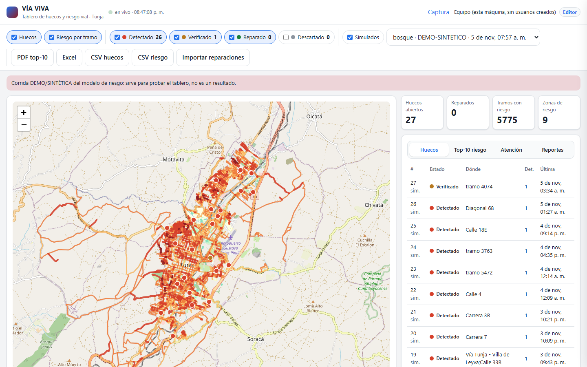

# VÍA VIVA

Detecta, mapea y **predice** huecos, resaltos, impactos y obstáculos en las vías de Tunja (Boyacá, Colombia), con IA en el
borde (una **Raspberry Pi 4** en el carro y el celular), un tablero web para la Alcaldía y un modelo de riesgo por
tramo de calle.
Proyecto Integrador 2026-2 · Ingeniería de Datos e Inteligencia Artificial · Universidad Santo Tomás, Seccional Tunja.
**No** genera multas ni lee placas.



*Tablero web en vivo (servido por la Pi, sin internet) con datos **DEMO** marcados: capa de huecos por estado y
capa de riesgo por tramo, top-10, orden de atención (montículo) y exportables. Tablero Java anterior: `docs/img/tablero_reportes.png`.*

## Un solo sistema

`viaviva.cmd capture` abre todo en `http://localhost:8000`: **Campo** (grabar y marcar) → **Sesiones** → **importar el
video** → **Revisión** → **Dataset** → **Demo** → **Tablero**. Sin Drive ni carpetas a mano.

## Salida de campo (lo urgente)

Doble clic en **`SALIDA_DE_CAMPO.cmd`**: corre `viaviva doctor` y, si está LISTO, la captura con phyphox y el tablero
en `http://localhost:8000`. Paso a paso de una página: **[`README_SALIDA.md`](README_SALIDA.md)**.

## Arrancar en 3 pasos (Windows, PowerShell)

1. **Clonar e instalar** (una vez; Python 3.11):
   ```powershell
   git clone --branch main https://github.com/via-viva-usta/via-viva.git; cd via-viva
   powershell -ExecutionPolicy Bypass -File viaviva\instalar_pc.ps1      # crea viaviva\.venv y un .env sin claves
   ```
2. **Probar sin carro** (recorrido SINTÉTICO que se crea solo; también sirve un export real de phyphox):
   ```powershell
   .\viaviva.cmd capture --replay ejemplo --por-http --abrir
   ```
   Salida de campo real, con los roles de cada persona: [`README_SALIDA.md`](README_SALIDA.md).
3. **Base de datos y demo completa** (OpenStreetMap, riesgo, mapa): `.\db\reconstruir.ps1` y `.\iniciar.ps1 -Demo`.

Todos los comandos: [`viaviva/README.md`](viaviva/README.md). Pruebas: `dataset\.venv\Scripts\python -m pytest`
(también en GitHub Actions, con `ruff` y cobertura).

## Cómo funciona

| Pieza | Qué hace | Dónde |
|---|---|---|
| **Salida de prueba (hoy)** | iPhone con phyphox + PC con `viaviva capture`: doctor, marcas 1–7, sincronía con video, RESUMEN | `viaviva/`, `SALIDA_DE_CAMPO.cmd` |
| **Nodo en el carro** | **Raspberry Pi 4** + ADXL345 (SPI, FIFO + interrupción) + MPU-6050 + VL53L0X + BH1750 + GPS + DHT22; detector por umbrales; SQLite local | `viaviva/` (en la Pi: `viaviva/instalar.sh`) |
| **Captura (celular o tablet fija)** | Página de la Pi con botones grandes: grabar, etiquetar, señal y GPS en vivo, estado de sensores, apagado seguro | `viaviva/web/captura.html`, `marcar.html` |
| **Línea base (R7)** | ESP32 + los mismos sensores con FIFO + DMA y doble núcleo: comparación de Arquitectura | `firmware/` |
| **Respaldo con phyphox** | phyphox en el iPhone por el acceso remoto: CSV en vivo, etiquetas con el teclado | `herramientas/captura_phyphox_remoto.py` |
| **Fotos (celular)** | Dataset propio de 9 clases con GPS y clima, tarjeta ArUco para la escala, CNN int8 que corre en el navegador del celular | `dataset/`, `web/clasificador/` |
| **Reportes ciudadanos** | Bot de Telegram: **pospuesto** (7-nov) | `futuro/bot/` |
| **Datos y riesgo** | ETL → SQLite → modelo de riesgo por tramo validado por barrios (plan B de etiquetas) | `etl/`, `db/`, `risk_model/` |
| **Tablero (Alcaldía)** | Web en vivo: huecos (detectado → verificado → reparado) y riesgo por tramo; roles (4 editores, Alcaldía y docentes de lectura); PDF/Excel/CSV; importar reparaciones; estructuras propias (tabla hash, montículo, BFS, geohash) | `viaviva/` (local), `web/en_linea/` (Netlify) |
| **Nube (opcional)** | Eventos, huecos y riesgo a Supabase, con cola y reintentos; SQLite local es la fuente de verdad | `viaviva/sincronizacion.py`, `docs/NUBE.md` |

**Estado honesto:** qué está probado con datos reales y qué no, en [`docs/ESTADO.md`](docs/ESTADO.md). Lo SINTÉTICO y lo
DEMO siempre van marcados y no se presentan como resultados. Contexto técnico completo: [`CLAUDE.md`](CLAUDE.md).

## Estructura

| Carpeta | Contenido |
|---|---|
| `firmware/` | PlatformIO, ESP32 `esp32dev` (nodo de sensores) y pruebas por sensor |
| `herramientas/` | Captura en vivo de phyphox y validador de lo que llega del campo |
| `analysis/` | Señales, detector por umbrales, entrenamiento del detector del nodo, conversor de vueltas |
| `dataset/` | Fotos: ingesta, planilla, etiquetador, escala ArUco, CNN, datasets externos |
| `etl/`, `db/`, `risk_model/` | OpenStreetMap, scraping, SQLite, recorridos y modelo de riesgo |
| `viaviva/` | La aplicación: captura (phyphox, Pi o reproducción), detector, dataset, tablero FastAPI, nube, R7 |
| `config/` | Parámetros del detector (`detector.yaml`) |
| `web/`, `dashboard-java/` | Mapa web estático y clasificador del celular; tablero NetBeans (versión anterior) |
| `docs/` | ARQUITECTURA, DATOS, SEGURIDAD, DISENO, NUBE, SCRAPING, R7, ESTADO; lo obsoleto en `docs/archivo/` |
| `web/en_linea/` | Tablero en línea (Netlify + Supabase) |
| `futuro/` | Trabajo futuro: bot de Telegram, ESP32-CAM, láser de cuadrícula, OBD2 |
| `tests/` | Pruebas pytest |

Los datos (`data/`), las fotos y los secretos (`.env`, `secretos.h`) **no** se suben al repositorio.

---

## Summary (English)

**VÍA VIVA** is a low-cost edge-AI system that detects, maps and predicts road hazards (potholes, speed bumps, severe impacts
and obstacles) in Tunja, Colombia. A vehicle-mounted ESP32 node with an accelerometer, IMU, laser time-of-flight sensor and
GPS classifies events on-device and logs temperature, humidity and light; a smartphone running phyphox streams live
accelerometer, gyroscope and GPS data to a laptop, where the co-driver labels hazards from the keyboard. The smartphone is
also the edge device for images: an own dataset of geotagged photos of nine road classes, an ArUco card for metric scale and
an int8 convolutional classifier that runs in the phone's browser. An ETL pipeline merges node events, citizen reports
(Telegram bot), web-scraped public sources and the OpenStreetMap street graph into SQLite. A georeferenced model estimates
the risk of unreported hazards per street segment, and a Java Swing dashboard ranks inspections and repairs for the
authorities. The system does not issue fines or read license plates.

Integrative Project 2026-2 — Data Engineering and AI, Universidad Santo Tomás (Tunja).
