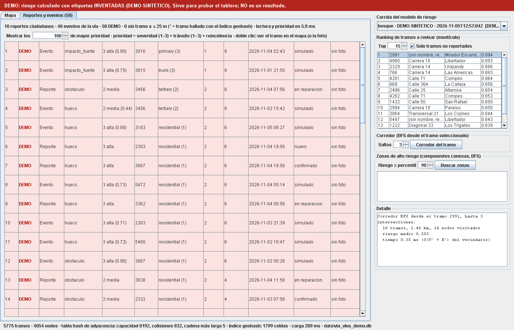

# dashboard-java/ — Tablero de riesgo vial

Proyecto **NetBeans · Java with Ant** (Java 21, Swing). Lee la base SQLite del ETL (`data/via_viva.db`) y dibuja el
grafo de calles de Tunja con cada tramo coloreado por su riesgo. Usa estructuras escritas a mano para el curso de
Estructuras de Datos: **tabla hash**, **montículo (heap)** y **grafo con BFS**, además del índice **geohash**.



*Captura generada con la corrida `DEMO-SINTETICO` (etiquetas inventadas): los colores no son un resultado.*

## Abrir y correr

1. NetBeans 25 → *File → Open Project* → elegir la carpeta `dashboard-java` (aparece como **TableroViaViva**).
2. Tener la base: desde `via-viva/` correr el ETL y el modelo (ver `risk_model/README.md`). El tablero busca
   `../data/via_viva.db`; si no está, pregunta dónde.
3. *Run Project* (F6). Rueda del ratón = zoom, arrastrar = mover, clic = elegir tramo.

Las pruebas de las estructuras: clic derecho en `viaviva/herramientas/PruebaEstructuras.java` → *Run File*.

Por consola (sin NetBeans), desde `dashboard-java/`, con el Ant que trae NetBeans:

```powershell
$NB = "C:\Program Files\NetBeans-25\netbeans"
& "$NB\extide\ant\bin\ant.bat" "-Dlibs.CopyLibs.classpath=$NB\java\ant\extra\org-netbeans-modules-java-j2seproject-copylibstask.jar" jar
java --enable-native-access=ALL-UNNAMED -jar dist\TableroViaViva.jar
java --enable-native-access=ALL-UNNAMED -jar dist\TableroViaViva.jar ..\data\via_viva.db --captura captura.png
java --enable-native-access=ALL-UNNAMED -jar dist\TableroViaViva.jar ..\data\via_viva.db --captura reportes.png --pestana reportes
java --enable-native-access=ALL-UNNAMED -cp "build\classes;lib\*" viaviva.herramientas.PruebaEstructuras
java -cp "build\classes;lib\*" viaviva.herramientas.PruebaPrioridad
```

`lib/sqlite-jdbc-3.47.1.0.jar` (driver JDBC de SQLite, 14 MB) **ya no va en el repositorio** (13-nov). Antes de abrir
el proyecto en NetBeans, bájelo una vez de Maven Central a `dashboard-java/lib/`:
`https://repo1.maven.org/maven2/org/xerial/sqlite-jdbc/3.47.1.0/sqlite-jdbc-3.47.1.0.jar`
(SHA-1 `c49b2969ec5a6ac6b34857401d184a2d1082c393`). `lib/*.jar` está en `.gitignore`.

## Qué muestra

| Panel | Qué hace | Estructura |
|---|---|---|
| Mapa | 5 775 tramos; color y grosor por quintil de riesgo (amarillo → rojo oscuro); gris = sin riesgo calculado | Geometrías en metros (proyección local) |
| Clic en el mapa | Encuentra el tramo más cercano | **Tabla hash** de celdas geohash → tramos |
| Ranking | Top-k tramos de mayor riesgo (opción: solo no reportados) | **Montículo de máximos** |
| Corredor | Calles a ≤ k intersecciones del tramo elegido | **Grafo** (lista de adyacencia en tabla hash) + **BFS** |
| Zonas de alto riesgo | Grupos de tramos con riesgo ≥ percentil p que se tocan entre sí (órdenes de trabajo candidatas) | **BFS** por componente conexa |
| Aviso rojo | Aparece si la corrida es `DEMO-*` | — |
| Barra inferior | Tamaño, capacidad, colisiones y cadena más larga de la tabla hash del grafo | — |
| Pestaña **Reportes y eventos** | Reportes ciudadanos (bot) y eventos de la vía (nodo / phyphox) en orden de atención, con clase, severidad, tramo, tipo de vía, reincidencia, prioridad, fecha, estado y miniatura de la foto. Doble clic = ver el tramo en el mapa (o la foto en grande). Lo DEMO va con la marca **DEMO** y fondo rojo claro | **Montículo de máximos** + **tabla hash** (conteo por tramo) + **índice geohash** (tramo de los reportes) |

### Reportes y eventos: prioridad de atención

**prioridad = severidad × tránsito × reincidencia** (mayor = atender primero).

| Factor | Regla |
|---|---|
| Severidad (1 leve, 2 media, 3 alta) | Eventos con `severidad` (0–1): < 1/3 → 1, < 2/3 → 2, si no → 3. Sin número (la tabla `reportes` no tiene esa columna y los eventos de phyphox la dejan vacía) se usa la clase: `hueco`, `impacto_fuerte` → 3; `obstaculo`, `otro` → 2; `resalto`, `vehiculo_varado` → 1 |
| Tránsito (1–3) | `tipo_via` del tramo OSM: `trunk`/`primary` (y `_link`) → 3; `secondary`/`tertiary` (y `_link`) → 2; `residential`, `unclassified` y otros → 1. Con varios valores (`unclassified;tertiary`) se toma el mayor. Sin tramo → 1 |
| Reincidencia | 1 + los otros reportes/eventos **abiertos** en el mismo tramo (o sea, cuántos hay en el tramo contándose a sí mismo), contados con `TablaHash`. Lo DEMO se cuenta aparte de lo real. Sin tramo → 1 |

- **Tramo:** el `id_tramo` de la base; si viene vacío (el bot no lo llena) se busca el más cercano a ≤ 25 m con el
  índice geohash (la misma distancia que el ETL de recorridos). En la tabla se marca con `*`.
- **Reportes cerrados** (`reparado`, `descartado`): prioridad 0, no cuentan para la reincidencia y salen al final.
- **Empates:** mayor severidad, luego la fecha más reciente, luego reportes antes que eventos.
- **Qué eventos se listan:** solo los de la vía (`hueco`, `resalto`, `impacto_fuerte`, `obstaculo`, como `web/exportar.py`);
  las maniobras y `normal` se cuentan en el encabezado pero no se listan.
- **DEMO:** eventos con `origen = 'simulado'` o con "demo" en `id_nodo`/`modelo_version`; reportes con "demo" en
  `hash_usuario` o `descripcion`. Nunca son resultados.
- **Fotos:** `foto_ruta` tal como la guarda el bot (`data\fotos_bot\<azar>.jpg`, relativa a `via-viva/`). El tablero la
  busca junto a la carpeta de la base; si no la encuentra muestra "no está". Las fotos del bot no se publican: solo se
  ven en el tablero local.
- **Sin datos:** si no hay reportes ni eventos (así está la base real hoy: 0 y 0), la pestaña dice "Todavía no hay reportes
  ciudadanos ni eventos de la vía en la base" y explica de dónde llegan (bot `/reportar`, `python -m etl.recorridos`, nodo).
  Si la lectura falla, muestra el error y el resto del tablero sigue funcionando.

## Código

```
src/viaviva/
├── TableroApp.java                 main: abre la ventana o genera una captura PNG (--captura)
├── control/ControladorTablero.java carga la base y arma las estructuras; consultas para la vista
├── control/PrioridadPeligros.java  prioridad = severidad × tránsito × reincidencia; top-k con el montículo
├── datos/RepositorioSQLite.java    JDBC de solo lectura (tramos, riesgo, reportes, eventos)
├── estructuras/
│   ├── TablaHash.java              encadenamiento separado, rehash al 75 %
│   ├── MonticuloMax.java           heap binario en arreglo, heapify de Floyd
│   ├── GrafoCalles.java            lista de adyacencia; corredor (BFS) y zonas (BFS por componente)
│   ├── IndiceGeohash.java          tabla hash geohash → tramos; búsqueda vs. fuerza bruta
│   └── Geohash.java                misma codificación que etl/geohash.py
├── modelo/                         Tramo, Corrida, Proyeccion, Peligro (reporte o evento)
├── vista/                          PanelTablero, PanelMapa, PanelPeligros (pestaña Reportes y eventos), Paleta
└── herramientas/                   PruebaEstructuras (pruebas y mediciones), PruebaPrioridad (orden de la prioridad)
```

Diagrama de clases: `docs/diagramas/04_clases_tablero_java.md`.

## Análisis de complejidad

Notación: n = tramos (aristas), V = intersecciones (nodos), P = puntos de geometría en total, k = tamaño del ranking,
m = tramos en las 9 celdas geohash alrededor de un punto.

| Operación | Estructura | Tiempo | Memoria | Alternativa ingenua |
|---|---|---|---|---|
| Armar tabla id → tramo | `TablaHash` | O(n) amortizado (rehash al duplicar) | O(n) | — |
| Buscar tramo por id | `TablaHash` | O(1) promedio, O(n) peor caso | — | Recorrer la lista: O(n) |
| Armar el grafo | `GrafoCalles` (adyacencia en `TablaHash`) | O(V + n) | O(V + n) | Matriz de adyacencia: O(V²) memoria (16 millones de celdas para V = 4 054) |
| Armar el índice espacial | `IndiceGeohash` | O(P + L/50 m), L = longitud total | O(celdas + registros) | — |
| Tramo más cercano a un clic | `IndiceGeohash` | O(1) para hallar las 9 celdas + O(m) | — | Fuerza bruta: O(n) |
| Top-k de riesgo | `MonticuloMax` | O(n) construir + O(k log n) extraer | O(n) | Ordenar todo: O(n log n) |
| Corredor a ≤ s saltos | `GrafoCalles.corredor` (BFS) | O(V' + E') del vecindario alcanzado | O(V') | — |
| Zonas de alto riesgo | `GrafoCalles.zonasDeRiesgo` (BFS) | O(V + n) + ordenar zonas O(z log z) | O(V) | Unir tramos por pares: O(n²) |

**Reportes y eventos** (r = reportes + eventos de la vía, k = filas que se muestran, m como arriba):

| Operación | Estructura | Tiempo | Memoria | Alternativa ingenua |
|---|---|---|---|---|
| Asignar tramo a un reporte sin `id_tramo` | `IndiceGeohash` | O(m) cada uno → O(r · m) | — | Fuerza bruta: O(r · n) |
| Conteo por tramo (reincidencia) | `TablaHash` tramo → cantidad | O(1) promedio por reporte/evento → O(r) | O(tramos distintos) | Comparar todos contra todos: O(r²) |
| Construir las prioridades | 2 pasadas (contar, multiplicar) | O(r) | O(r) | — |
| Armar el montículo | `MonticuloMax` (heapify de Floyd) | O(r) | O(r) | — |
| Extraer el top-k | `MonticuloMax.extraerK` | O(k log r) | O(k) | Ordenar todo: O(r log r) |

### Mediciones (26-oct-2026, este PC, base real de Tunja)

Salen de `PruebaEstructuras`; los tiempos cambian de un PC a otro y entre corridas.

| Medida | Valor |
|---|---|
| Carga de la base y armado de todas las estructuras | ~240 ms (5 775 tramos, 4 054 nodos, 1 799 celdas geohash) |
| Tabla hash del grafo | 4 054 llaves en capacidad 8 192; 832 colisiones al insertar; cadena más larga: 5 |
| Tramo más cercano, 2 000 búsquedas | Índice geohash: **108** comparaciones y ~9 µs en promedio · Fuerza bruta: **5 775** comparaciones y ~180 µs. Mismo tramo en las 2 000 (con desempate por id) |
| Top-20 con montículo vs. ordenar los 5 775 | ~1,4–1,7 ms vs. ~2,1–3,5 ms |
| BFS del corredor (3 saltos) | 15 tramos, 14 nodos visitados, < 0,5 ms |
| Zonas de riesgo (todo el grafo) | ~4–7 ms |

El número y el tamaño de las zonas dependen de los valores de riesgo; con la corrida DEMO no significan nada.

### Pruebas automáticas (`PruebaEstructuras` y `PruebaPrioridad`)

`PruebaPrioridad` (también la corre `PruebaEstructuras`) usa 9 reportes/eventos de ejemplo **inventados en memoria**:
verifica la regla de severidad y de tránsito, la reincidencia (los cerrados y lo DEMO no la suben), el orden completo
con sus empates, que el top-3 del montículo es el esperado, que el montículo da lo mismo que ordenar con el mismo criterio
y que una lista vacía no falla. Con la base, `PruebaEstructuras` verifica además que reportes y eventos se leen sin error.

Todas pasan: geohash contra un valor de referencia y contra `etl/geohash.py`; `TablaHash` igual a `HashMap` en
200 000 operaciones al azar; top-100 del montículo igual al de ordenar; BFS en una rejilla 4 × 4 con resultado conocido;
con la base real, índice y fuerza bruta devuelven el mismo tramo, y cada tramo sobre el umbral cae en exactamente una zona.

## Estado y limitaciones

- **Compila y empaqueta** con el Ant de NetBeans 25 (`BUILD SUCCESSFUL`). `build.xml` y `nbproject/build-impl.xml` se
  generaron con las mismas plantillas XSL de NetBeans 25. **No lo he abierto en el IDE** (no puedo manejar su interfaz):
  si NetBeans ofrece regenerar `build-impl.xml` al abrirlo, aceptar.
- En este PC solo está el JDK 25; el proyecto apunta a Java 21 (`javac.source/target = 21`). Ant avisa
  "location of system modules is not set": es esperado al compilar para 21 con un JDK más nuevo. Se comprobó aparte con
  `javac --release 21` que el código solo usa la API de Java 21.
- La ventana se probó dibujándola fuera de pantalla (`--captura`); la interacción con el ratón no se ha probado a mano.
- La pestaña **Reportes y eventos** se probó con la base real (0 reportes y 0 eventos: estado vacío) y con una copia de la
  base con reportes/eventos DEMO insertados a mano (fuera del repositorio), dibujándola con `--captura ... --pestana
  reportes`. El doble clic (ir al mapa, ver la foto) no se ha probado a mano.
- Pendiente del diagrama de clases original: bitácora por fechas con `TreeMap` y cambio de estado de los reportes desde
  el tablero (hoy se cambia con `bot/cambiar_estado.py`).
