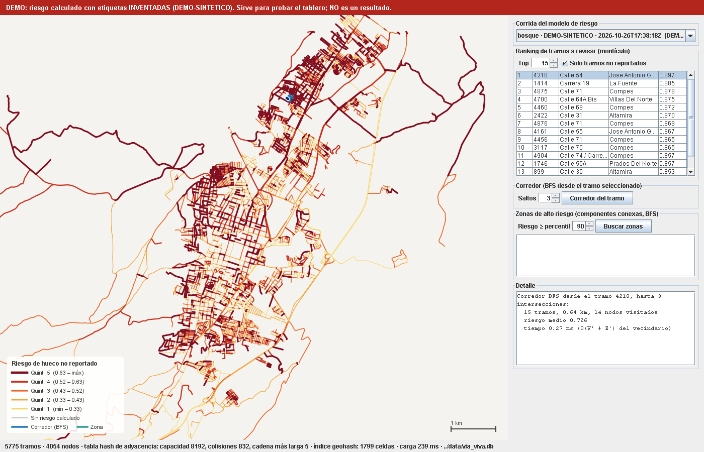

# dashboard-java/ — Tablero de riesgo vial

Proyecto **NetBeans · Java with Ant** (Java 21, Swing). Lee la base SQLite del ETL (`data/via_viva.db`) y dibuja el
grafo de calles de Tunja con cada tramo coloreado por su riesgo. Usa estructuras escritas a mano para el curso de
Estructuras de Datos: **tabla hash**, **montículo (heap)** y **grafo con BFS**, además del índice **geohash**.



*Captura generada con la corrida `DEMO-SINTETICO` (etiquetas inventadas): los colores no son un resultado.*

## Abrir y correr

1. NetBeans 25 → *File → Open Project* → elegir la carpeta `dashboard-java` (aparece como **TableroViaViva**).
2. Tener la base: desde `via-viva/` correr el ETL y el modelo (ver `risk_model/README.md`). El tablero busca
   `../data/via_viva.db`; si no está, pregunta dónde.
3. *Run Project* (F6). Rueda del ratón = zoom, arrastrar = mover, clic = elegir tramo.

Las pruebas de las estructuras: clic derecho en `viaviva/herramientas/PruebaEstructuras.java` → *Run File*.

Por consola (sin NetBeans), desde `dashboard-java/`, con el Ant que trae NetBeans:

```powershell
$NB = "C:\Program Files\NetBeans-25\netbeans"
& "$NB\extide\ant\bin\ant.bat" "-Dlibs.CopyLibs.classpath=$NB\java\ant\extra\org-netbeans-modules-java-j2seproject-copylibstask.jar" jar
java --enable-native-access=ALL-UNNAMED -jar dist\TableroViaViva.jar
java --enable-native-access=ALL-UNNAMED -jar dist\TableroViaViva.jar ..\data\via_viva.db --captura captura.png
java --enable-native-access=ALL-UNNAMED -cp "build\classes;lib\*" viaviva.herramientas.PruebaEstructuras
```

`lib/sqlite-jdbc-3.47.1.0.jar` (driver JDBC de SQLite, Maven Central, checksum SHA-1 verificado) va en el repositorio
para que el proyecto abra sin configurar nada.

## Qué muestra

| Panel | Qué hace | Estructura |
|---|---|---|
| Mapa | 5 775 tramos; color y grosor por quintil de riesgo (amarillo → rojo oscuro); gris = sin riesgo calculado | Geometrías en metros (proyección local) |
| Clic en el mapa | Encuentra el tramo más cercano | **Tabla hash** de celdas geohash → tramos |
| Ranking | Top-k tramos de mayor riesgo (opción: solo no reportados) | **Montículo de máximos** |
| Corredor | Calles a ≤ k intersecciones del tramo elegido | **Grafo** (lista de adyacencia en tabla hash) + **BFS** |
| Zonas de alto riesgo | Grupos de tramos con riesgo ≥ percentil p que se tocan entre sí (órdenes de trabajo candidatas) | **BFS** por componente conexa |
| Aviso rojo | Aparece si la corrida es `DEMO-*` | — |
| Barra inferior | Tamaño, capacidad, colisiones y cadena más larga de la tabla hash del grafo | — |

## Código

```
src/viaviva/
├── TableroApp.java                 main: abre la ventana o genera una captura PNG (--captura)
├── control/ControladorTablero.java carga la base y arma las estructuras; consultas para la vista
├── datos/RepositorioSQLite.java    JDBC de solo lectura (tramos, riesgo)
├── estructuras/
│   ├── TablaHash.java              encadenamiento separado, rehash al 75 %
│   ├── MonticuloMax.java           heap binario en arreglo, heapify de Floyd
│   ├── GrafoCalles.java            lista de adyacencia; corredor (BFS) y zonas (BFS por componente)
│   ├── IndiceGeohash.java          tabla hash geohash → tramos; búsqueda vs. fuerza bruta
│   └── Geohash.java                misma codificación que etl/geohash.py
├── modelo/                         Tramo, Corrida, Proyeccion
├── vista/                          PanelTablero, PanelMapa, Paleta
└── herramientas/PruebaEstructuras.java   pruebas y mediciones
```

Diagrama de clases: `docs/diagramas/04_clases_tablero_java.md`.

## Análisis de complejidad

Notación: n = tramos (aristas), V = intersecciones (nodos), P = puntos de geometría en total, k = tamaño del ranking,
m = tramos en las 9 celdas geohash alrededor de un punto.

| Operación | Estructura | Tiempo | Memoria | Alternativa ingenua |
|---|---|---|---|---|
| Armar tabla id → tramo | `TablaHash` | O(n) amortizado (rehash al duplicar) | O(n) | — |
| Buscar tramo por id | `TablaHash` | O(1) promedio, O(n) peor caso | — | Recorrer la lista: O(n) |
| Armar el grafo | `GrafoCalles` (adyacencia en `TablaHash`) | O(V + n) | O(V + n) | Matriz de adyacencia: O(V²) memoria (16 millones de celdas para V = 4 054) |
| Armar el índice espacial | `IndiceGeohash` | O(P + L/50 m), L = longitud total | O(celdas + registros) | — |
| Tramo más cercano a un clic | `IndiceGeohash` | O(1) para hallar las 9 celdas + O(m) | — | Fuerza bruta: O(n) |
| Top-k de riesgo | `MonticuloMax` | O(n) construir + O(k log n) extraer | O(n) | Ordenar todo: O(n log n) |
| Corredor a ≤ s saltos | `GrafoCalles.corredor` (BFS) | O(V' + E') del vecindario alcanzado | O(V') | — |
| Zonas de alto riesgo | `GrafoCalles.zonasDeRiesgo` (BFS) | O(V + n) + ordenar zonas O(z log z) | O(V) | Unir tramos por pares: O(n²) |

### Mediciones (26-oct-2026, este PC, base real de Tunja)

Salen de `PruebaEstructuras`; los tiempos cambian de un PC a otro y entre corridas.

| Medida | Valor |
|---|---|
| Carga de la base y armado de todas las estructuras | ~240 ms (5 775 tramos, 4 054 nodos, 1 799 celdas geohash) |
| Tabla hash del grafo | 4 054 llaves en capacidad 8 192; 832 colisiones al insertar; cadena más larga: 5 |
| Tramo más cercano, 2 000 búsquedas | Índice geohash: **108** comparaciones y ~9 µs en promedio · Fuerza bruta: **5 775** comparaciones y ~180 µs. Mismo tramo en las 2 000 (con desempate por id) |
| Top-20 con montículo vs. ordenar los 5 775 | ~1,4–1,7 ms vs. ~2,1–3,5 ms |
| BFS del corredor (3 saltos) | 15 tramos, 14 nodos visitados, < 0,5 ms |
| Zonas de riesgo (todo el grafo) | ~4–7 ms |

El número y el tamaño de las zonas dependen de los valores de riesgo; con la corrida DEMO no significan nada.

### Pruebas automáticas (`PruebaEstructuras`)

Todas pasan: geohash contra un valor de referencia y contra `etl/geohash.py`; `TablaHash` igual a `HashMap` en
200 000 operaciones al azar; top-100 del montículo igual al de ordenar; BFS en una rejilla 4 × 4 con resultado conocido;
con la base real, índice y fuerza bruta devuelven el mismo tramo, y cada tramo sobre el umbral cae en exactamente una zona.

## Estado y limitaciones

- **Compila y empaqueta** con el Ant de NetBeans 25 (`BUILD SUCCESSFUL`). `build.xml` y `nbproject/build-impl.xml` se
  generaron con las mismas plantillas XSL de NetBeans 25. **No lo he abierto en el IDE** (no puedo manejar su interfaz):
  si NetBeans ofrece regenerar `build-impl.xml` al abrirlo, aceptar.
- En este PC solo está el JDK 25; el proyecto apunta a Java 21 (`javac.source/target = 21`). Ant avisa
  "location of system modules is not set": es esperado al compilar para 21 con un JDK más nuevo. Se comprobó aparte con
  `javac --release 21` que el código solo usa la API de Java 21.
- La ventana se probó dibujándola fuera de pantalla (`--captura`); la interacción con el ratón no se ha probado a mano.
- Pendiente del diagrama de clases original: eventos y reportes como "peligros" (agrupados con el índice geohash),
  bitácora por fechas con `TreeMap` y ciclo de reparación. Se agregan cuando haya eventos del nodo y del bot.
