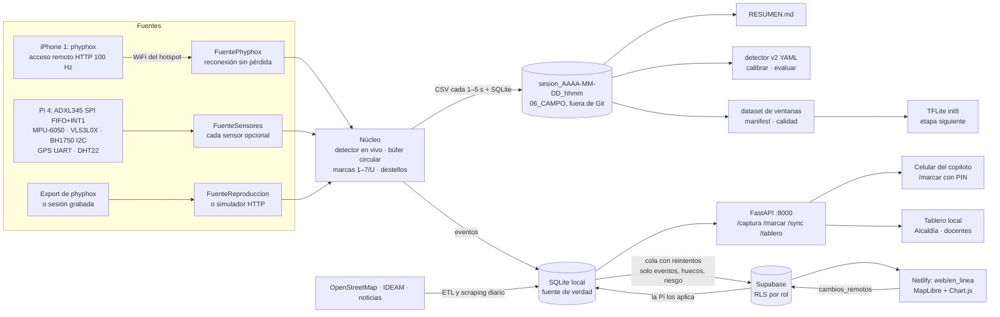

# Arquitectura de VÍA VIVA (10-nov-2026)

Una sola aplicación, `viaviva/`, con la fuente de datos intercambiable: **phyphox** (iPhone + PC, salidas de prueba),
**pi** (sensores en la Raspberry Pi 4) o **replay** (una grabación como si fuera en vivo). La ESP32 salió del proyecto el
9-nov (queda en `firmware/` como alternativa descartada por recursos).

## Módulos (`viaviva/`)

| Módulo | Qué hace |
|---|---|
| `cli.py` | `viaviva doctor · capture · serve · resumen · detector · dataset · modelo · r7 · usuarios · sync · nube` |
| `doctor.py` | Pre-chequeo: phyphox, flujo 100 Hz, GPS, hora, disco, batería, puerto, IP; en la Pi, cada sensor |
| `fuente_phyphox.py`, `simulador_phyphox.py` | Captura en vivo por HTTP y su imitación para pruebas |
| `fuentes.py`, `sensores.py` | Sensores de la Pi (pines del manual v3) y reproducción |
| `nucleo.py` | Detector en vivo, sesión (formato phyphox + UTC del PC), marcas con retardo y deshacer, destellos, bitácora |
| `resumen.py` | RESUMEN.md: duración, pérdidas, marcas, km, velocidad, minuto quieto |
| `senal.py`, `detector.py` | Eje vertical por gravedad, detector calibrable (`config/detector.yaml`) y evaluación por salida |
| `ventanas.py`, `modelo_ventanas.py` | Dataset de ventanas de 2 s y esqueleto TFLite |
| `almacen.py`, `estructuras.py` | SQLite (huecos, prioridad, riesgo) y estructuras de datos propias |
| `sesiones.py` | Flujo único del dataset: lista de sesiones, importar y sincronizar video, revisión, construir dataset |
| `app.py`, `usuarios.py`, `exportar.py` | FastAPI, roles, PDF/CSV/Excel e importación de reparaciones |
| `sincronizacion.py`, `nube.py`, `supabase_esquema.sql` | Outbox a Supabase, cambios en línea y preparación del sitio |
| `sistema.py`, `r7/medir.py` | Salud del equipo y R7 |

## Estructuras de datos que se usan de verdad (Estructuras de Datos)

| Estructura | Dónde se usa | Para qué | Costo |
|---|---|---|---|
| **Búfer circular** (`BuferCircular`) | `nucleo.py`: ventana pico a pico del detector, últimas 600 muestras de la gráfica, eventos y marcas recientes | Memoria fija mientras se captura | O(1) por muestra |
| **Montículo máximo** (`MonticuloMax`, `top_k`) | `almacen.riesgo` (top-10 de 5 775 tramos) y `almacen.peligros` (orden de atención) | Cola de prioridad por riesgo y por severidad × tránsito × reincidencia | O(n + k log n) |
| **Tabla hash** (`TablaHash`) | `almacen.peligros` (reincidencia por tramo), `Calles.info` (tramo por id), índice geohash | Conteos y búsquedas por llave | O(1) promedio |
| **Cuadrícula espacial geohash** (`IndiceGeohash`) | `Calles.ajustar` (evento → calle sin internet) y `almacen.agrupar_huecos` (detecciones ≤ 10 m → un hueco) | Vecinos sin recorrer todo | O(1) + candidatos de 9 celdas |
| **Grafo + BFS** (`GrafoCalles`) | `/api/tablero/corredor` (tramos a ≤ 2 intersecciones) y zonas de riesgo conectadas | Zona de influencia de un tramo | O(V + E) |
| **Cola FIFO** (`Cola`) | Frontera del BFS | | O(1) amortizado |

Pruebas: `tests/test_viaviva.py` (cada estructura contra la de Python y casos límite).
