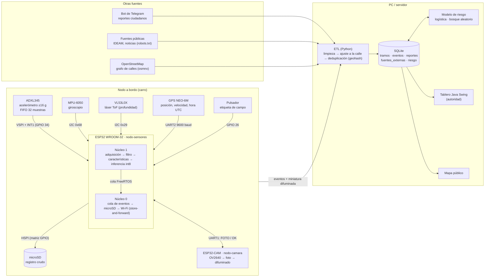
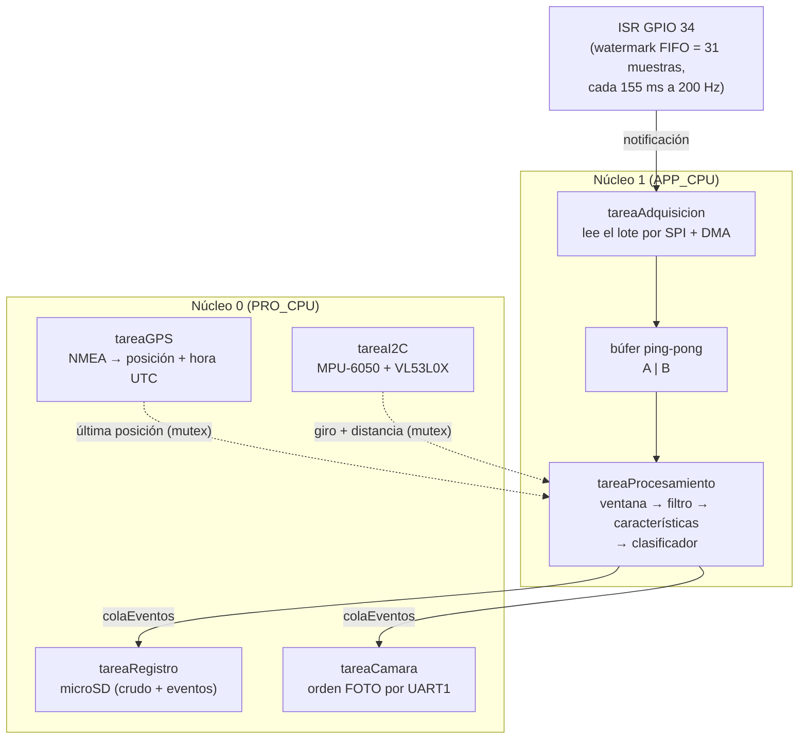
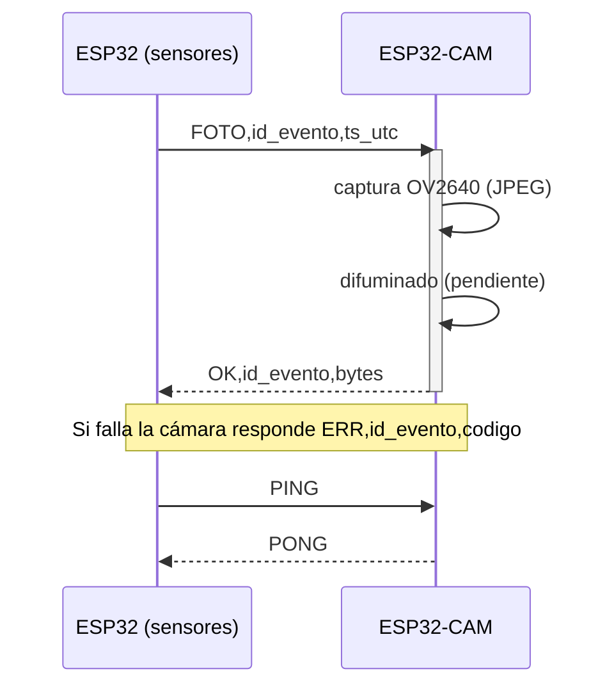

# Arquitectura del sistema

GitHub y VS Code muestran estos diagramas directamente (Mermaid).

## Vista general

## Reparto de trabajo dentro del ESP32

## Protocolo UART entre nodo-sensores y nodo-camara

Texto ASCII, una orden por línea (terminada en salto de línea), 115200 baud.

