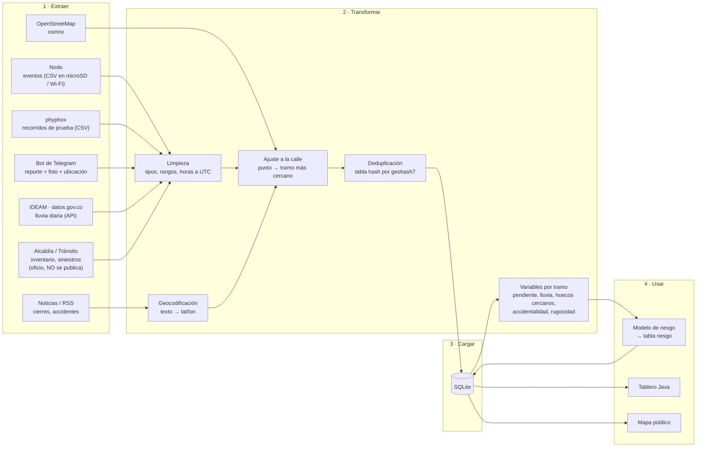

# Flujo de datos (ETL)

## Reglas que el flujo hace cumplir

| Paso | Regla |
|---|---|
| Extraer (nodo) | Solo eventos; nunca la trayectoria completa del carro |
| Extraer (bot) | El `chat_id` se guarda como hash con sal, no en claro |
| Extraer (web) | Solo fuentes que permiten acceso automatizado (`robots.txt`), con espera entre peticiones |
| Extraer (Alcaldía) | Se guarda en `data/alcaldia/` (ignorada por Git) |
| Transformar | Horas en UTC; coordenadas WGS84 |
| Deduplicar | Eventos y reportes en la misma celda geohash7 (~153 m) y ventana de tiempo → un solo peligro |
| Cargar | `hash_contenido` único en `fuentes_externas`; `(id_nodo, ts_utc)` único en `eventos` |

## Estado actual

| Pieza | Estado |
|---|---|
| OpenStreetMap → `tramos` | Hecho (`etl/osm_tunja.py`) |
| IDEAM → `fuentes_externas` | Hecho (`etl/scraping/clima_ideam.py`) |
| Noticias → `fuentes_externas` | Plantilla (`etl/scraping/noticias.py`) |
| phyphox → análisis | Fase 3 (`analysis/`) |
| Nodo, bot, ajuste a la calle, deduplicación, variables por tramo | Pendiente |
