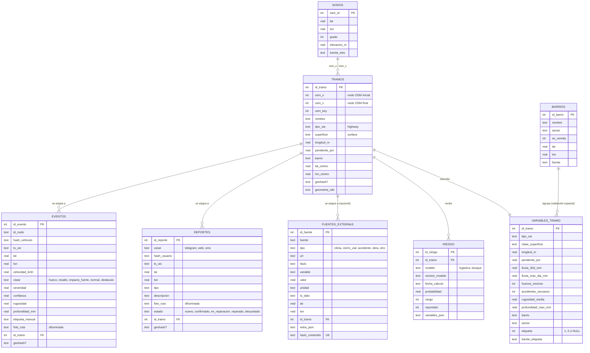

# Modelo entidad-relación

Corresponde a `db/schema.sql`. El tramo de calle (OpenStreetMap) es la unidad que une todo.
`nodos`, `barrios` y `variables_tramo` se agregaron en la Fase 4 (modelo de riesgo).

**Nota de diseño.** El ciclo de vida del peligro (nuevo → confirmado → en reparación → reparado) está hoy en `reportes.estado`.
Cuando el ETL agrupe eventos y reportes por geohash, conviene una tabla `peligros` (un registro por grupo) con su propio estado;
se agrega cuando exista la deduplicación.
