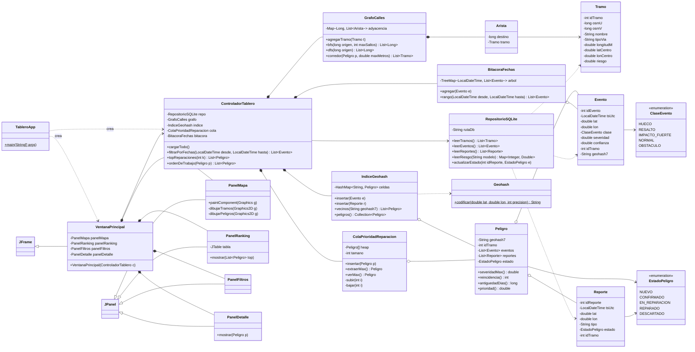

# Clases UML del tablero Java (propuesta)

Proyecto NetBeans *Java with Ant*, Java 21, Swing. Lee la base SQLite con JDBC (`sqlite-jdbc` en `lib/`).
Las estructuras de datos del curso se implementan a mano (no se usan `PriorityQueue` ni grafos de librerías)
para poder analizar su complejidad; `HashMap` y `TreeMap` de Java se usan donde el curso lo permite.

## Complejidad esperada (para el informe de Estructuras de Datos)

| Operación | Estructura | Complejidad |
|---|---|---|
| Agrupar n eventos en peligros | `IndiceGeohash` (tabla hash) | O(n) promedio vs. O(n²) por fuerza bruta |
| Peligros del mismo corredor | `GrafoCalles.bfs` / `dfs` | O(V + E) |
| Top-k de reparación | `ColaPrioridadReparacion` (heap binario) | O(n) construir + O(k log n) |
| Eventos entre dos fechas | `BitacoraFechas` (`TreeMap`, árbol rojo-negro) | O(log n + m) |

Prioridad de reparación (diseño, sección 8): `severidad × tránsito × reincidencia × antigüedad`.
