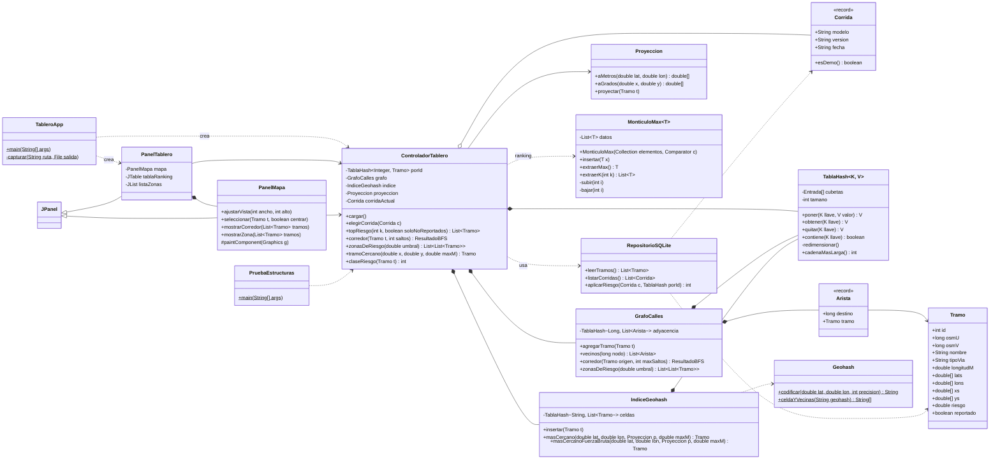

# Clases UML del tablero Java

Proyecto NetBeans *Java with Ant*, Java 21, Swing (`dashboard-java/`). Lee la base SQLite con JDBC (`sqlite-jdbc` en `lib/`).
Las estructuras del curso se implementan a mano (`TablaHash`, `MonticuloMax`, `GrafoCalles`) para poder analizar su complejidad.

## Implementado (Fase 5)

## Pendiente (cuando haya eventos del nodo y reportes del bot)

| Clase | Estructura | Para qué |
|---|---|---|
| `Evento`, `Reporte`, `Peligro`, `EstadoPeligro` | — | Agrupar eventos y reportes cercanos en un solo peligro con ciclo nuevo → confirmado → en reparación → reparado |
| `IndiceGeohash` (ampliado) | Tabla hash | Agrupar eventos por celda: O(n) promedio vs. O(n²) comparando todos contra todos |
| `BitacoraFechas` | `TreeMap` (árbol rojo-negro) | Eventos entre dos fechas en O(log n + m) |
| `MonticuloMax` (otra prioridad) | Heap | Ranking de reparación: severidad × tránsito × reincidencia × antigüedad |

La complejidad de lo implementado está en `dashboard-java/README.md`.
