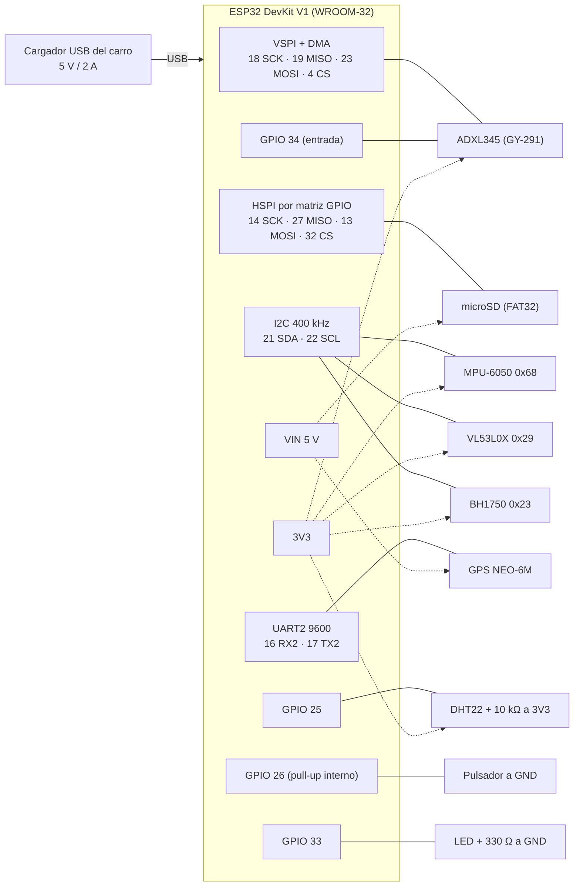

# Montaje del nodo VÍA VIVA (ESP32 DevKit V1 de 30 pines, WROOM-32)

Guía para armar y probar el hardware **por partes**. Responsable: Dany (área A), apoyo Juan Diego.
Programas de prueba: `firmware/nodo-sensores/pruebas/` (cada uno termina con `RESULTADO: PASA` o `FALLA` y una pista).
Fuente única de los pines en el código: `firmware/nodo-sensores/include/pines.h`.

> **Estado (5-nov-2026):** todo lo de esta guía sale de las hojas de datos y del código; **nada se ha probado todavía en
> la placa**. Lo que solo se sabe midiendo está marcado `[VALIDAR EN PLACA]`.

## 1. Tabla final de conexiones

En la DevKit V1 de 30 pines los GPIO vienen rotulados `D4`, `D18`, ... y los de la UART2 como `RX2` (GPIO 16) y `TX2`
(GPIO 17). Algunos clones rotulan `G16` o solo `16`: lo que vale es el **número de GPIO**.

| Componente | Pin del módulo | GPIO ESP32 (rótulo) | Alimentación | Notas |
|---|---|---|---|---|
| **ADXL345** (GY-291), SPI | CS | 4 (`D4`) | **3V3** + GND | VSPI con DMA. Atornillado plano a la base (es el sensor principal) |
| | SCL/SCK | 18 (`D18`) | | |
| | SDO/MISO | 19 (`D19`) | | |
| | SDA/MOSI | 23 (`D23`) | | |
| | INT1 | 34 (`D34`) | | Solo entrada; el INT1 empuja la línea, no necesita resistencia. INT2 suelto |
| **MPU-6050** (GY-521), I2C 0x68 | SDA / SCL | 21 (`D21`) / 22 (`D22`) | **3V3** + GND | AD0 a GND o suelto. **X hacia adelante del carro, Z hacia arriba**. XDA, XCL e INT sueltos |
| **VL53L0X**, I2C 0x29 | SDA / SCL | 21 / 22 | **3V3** + GND | Mismo bus. XSHUT y GPIO1 sueltos. Apunta al piso |
| **BH1750** (GY-302), I2C 0x23 | SDA / SCL / ADDR | 21 / 22 / GND | **3V3** + GND | ADDR a GND = 0x23. Mirando hacia arriba, sin sombra de la caja |
| **DHT22** (AM2302) | DATA | 25 (`D25`) | **3V3** + GND | **Pull-up de 10 kΩ entre DATA y 3V3** (el módulo de 3 pines ya la trae; el sensor suelto de 4 patas no: pata 1 VCC, 2 DATA, 3 sin conectar, 4 GND). Cable < 1 m. Fuera de la caja |
| **GPS NEO-6M** (GY-NEO6MV2), UART2 | TX → | 16 (`RX2`) | VCC del módulo a **VIN (5 V)** si trae regulador (casi todos), si no 3V3; + GND | 9600 baud. **Cruzado:** TX del GPS al RX de la ESP32. Antena hacia el cielo |
| | RX ← | 17 (`TX2`) | | |
| **microSD** (módulo SPI) | CS / SCK / MOSI / MISO | 32 (`D32`) / 14 (`D14`) / 13 (`D13`) / 27 (`D27`) | **VIN (5 V)** si el módulo trae regulador AMS1117; si no, 3V3 | HSPI por la matriz GPIO. Tarjeta ≤ 32 GB en **FAT32** |
| **Pulsador** | una pata / otra | 26 (`D26`) / GND | — | Pull-up interno; antirrebote por software (250 ms) |
| **LED** | ánodo (con 220–330 Ω en serie) / cátodo | 33 (`D33`) / GND | — | Códigos de estado (sección 6) |
| **Alimentación** | USB de la DevKit | — | Cargador USB de carro **5 V / 2 A** | Ver sección 2. VIN ≈ 5 V del USB (en la mayoría de las DevKit V1 pasa por un diodo) |

**Bus I2C (21/22):** MPU-6050, VL53L0X y BH1750 en paralelo a 400 kHz. Los módulos GY traen sus propias resistencias de
pull-up (normalmente 4,7–10 kΩ); con tres módulos quedan en paralelo y funciona. Si el bus da errores con cables largos,
quitar las de un módulo o bajar a 100 kHz.

**BME280:** el código lo sigue aceptando (I2C 0x76/0x77, a 3V3) y lo prefiere si lo encuentra, pero **no se compró**.

**Pines que NO se usan:** 0, 2, 5, 12, 15 (arranque), 6–11 (flash interna), 1 y 3 (monitor serie). 34–39 son solo
entradas y sin pull-up. Libres para el futuro: 35 (solo entrada), 36 (`VP`), 39 (`VN`).

> **3-nov-2026:** la ESP32-CAM y el CP2102 salieron del diseño (la evidencia la toma el celular, `docs/protocolo_fotos.md`).
> Los GPIO 25 y 35 quedaron libres; el 25 se usa para el DHT22.

## 2. Alimentación desde el carro

```
 Encendedor del carro (12 V) ──► cargador USB 5 V / 2 A ──► cable USB corto y grueso ──► DevKit (USB)
                                                                                         ├─ VIN (5 V) ──► GPS, microSD
                                                                                         └─ regulador 3,3 V ──► 3V3 ──► ADXL345, MPU-6050,
                                                                                                                         VL53L0X, BH1750, DHT22
```

- Un solo camino de alimentación: el **USB de la DevKit**. No conectar a la vez el USB del PC y otra fuente en VIN.
- Consumo **estimado** con las hojas de datos (no medido): ESP32 con Wi-Fi en punto de acceso hasta ~0,25 A en los picos de
  transmisión, GPS ~0,05 A, microSD hasta ~0,1 A al escribir, el resto de sensores < 0,03 A juntos. Unos **0,4–0,5 A en
  picos**: el cargador de 2 A sobra. La corriente real se mide con el tester USB (`docs/experimentos.md`) `[VALIDAR EN PLACA]`.
- Lo que más falla es el **cable**: uno delgado o largo baja el voltaje en los picos del Wi-Fi y aparece *Brownout*
  (sección 5). Cable de ≤ 1 m que sirva para cargar rápido.
- **Condensador de 470 µF (≥ 10 V) entre VIN y GND** en la baquela, cerca de la ESP32: aguanta los picos del Wi-Fi.
- **Encender el nodo con el motor ya prendido:** al dar arranque, el voltaje del carro cae y el cargador puede cortar;
  el nodo se reiniciaría (queda como "bajo voltaje" en la página y empieza una sesión nueva; no se pierde lo guardado).
- Al apagar el carro el nodo se apaga de golpe: se pierde como máximo ~1 s de datos (los archivos se fuerzan a la
  tarjeta cada segundo). Pasarle `chkdsk` a la tarjeta en el PC antes de copiar.

## 3. Diagrama de conexiones



Simulación: `firmware/nodo-sensores/diagram.json` (Wokwi, `wokwi-esp32-devkit-v1`) tiene la ESP32, el MPU-6050, la
microSD, el **DHT22 con su pull-up**, el pulsador y el LED. Wokwi **no tiene** ADXL345, VL53L0X, BH1750 ni GPS
(ver `firmware/nodo-sensores/wokwi/README.md`).

## 4. Checklist antes de energizar

- [ ] Todos los GND unidos (ESP32, sensores, GPS, microSD).
- [ ] Ningún sensor de 3,3 V conectado a 5 V (ADXL345, MPU-6050, VL53L0X, BH1750 y DHT22 van a **3V3**).
- [ ] Nada conectado a los pines 0, 2, 5, 12 ni 15.
- [ ] TX del GPS → GPIO 16 (cruzado: TX con RX).
- [ ] Pull-up de 10 kΩ del DHT22 puesta (o módulo de 3 pines que ya la trae).
- [ ] Cables de SPI cortos (< 20 cm) y lejos de los de alimentación.
- [ ] La microSD formateada en FAT32 y puesta antes de encender.
- [ ] Condensador de 470 µF entre VIN y GND, con la polaridad correcta.
- [ ] Multímetro: 3,3 V entre 3V3 y GND; ~5 V entre VIN y GND con el USB puesto.

## 5. Orden de prueba

Un componente a la vez; si uno falla, no seguir sumando. Desde `firmware/nodo-sensores/pruebas`
(si Windows bloquea `pio.exe`: `%USERPROFILE%\.platformio\penv\Scripts\python.exe -m platformio ...`):

| # | Prueba | Comando | Qué debe salir |
|---|---|---|---|
| 1 | Placa sola | `pio run -e boton_led -t upload` y `pio device monitor` | LED parpadea 3 veces; 3 pulsaciones detectadas |
| 2 | Bus I2C | `pio run -e i2c -t upload` | Dispositivos en 0x68 y 0x29 (y 0x23 con el BH1750) |
| 3 | MPU-6050 | `pio run -e mpu6050 -t upload` | WHO_AM_I, \|a\| ≈ 1 g; girar a la izquierda → giro Z **positivo** |
| 4 | VL53L0X | `pio run -e vl53l0x -t upload` | ≥ 45/50 lecturas válidas, desviación < 15 mm |
| 5 | ADXL345 | `pio run -e adxl345 -t upload` | DEVID 0xE5, \|a\| ≈ 1 g, INT1 activo |
| 6 | microSD | `pio run -e microsd -t upload` | Monta, escribe 256 KB > 50 KB/s y relee igual |
| 7 | GPS | `pio run -e gps -t upload` | Datos y NMEA bajo techo; fijación **al aire libre** |
| 8 | DHT22 | `pio run -e dht22 -t upload` | ≥ 8 de 10 lecturas correctas; soplar sube la humedad |
| 9 | BH1750 | `pio run -e bh1750 -t upload` | Responde en 0x23; tapar el sensor baja la luz |
| 10 | Todo junto | `cd ..` y `pio run -t upload` | Arranque con todo `OK` en el monitor; LED con **parpadeo lento** al aire libre (o 1 destello bajo techo) |
| 11 | Página web | Celular a `VIA-VIVA-NODO` → http://192.168.4.1 | Gráfica moviéndose al golpear la mesa; tarjeta **Ambiente** con °C y % HR; microSD "guardando la sesión NNN"; GPS con datos |
| 12 | Etiquetas y modo mesa | Botón Hueco + "Modo mesa" + golpe a la caja | LED con parpadeo rápido 1 s; evento en "Último evento" |
| 13 | Descarga | "Ver archivos" → tocar `eventos_NNN.csv` | El CSV baja al celular con el encabezado y las filas |
| 14 | Robustez | Sacar la microSD 20 s y volver a meterla; desconectar el TX del GPS 10 s | LED 3 destellos → vuelve solo; "remontajes 1". GPS: 2 destellos y "UART reiniciada N veces" |
| 15 | E1 | Monitor serie, 1 min | Línea `E1,...` cada 5 s con `overruns=0`, también **mientras se descarga** un CSV |

`pio run -e bme280` solo si algún día se pone un BME280. Anotar cada resultado en el issue #1 de GitHub.

## 6. Códigos del LED (GPIO 33)

| LED | Significado | Qué hacer |
|---|---|---|
| Encendido fijo | Arrancando (setup y experimentos E2–E4, unos segundos) | Esperar. Si no cambia en ~30 s: ver el monitor serie |
| Parpadeo lento (0,5 s / 0,5 s) | Todo bien: muestras, microSD y fijación GPS | — |
| 1 destello corto y pausa | Sin fijación GPS | Normal bajo techo y los primeros 1–5 min |
| 2 destellos cortos y pausa | GPS sin datos (no llegan bytes NMEA) | TX del GPS → 16, alimentación del GPS |
| 3 destellos cortos y pausa | microSD sin montar o fallando: **no se guarda** | Revisar la tarjeta; se reintenta sola cada 10 s |
| 4 destellos cortos y pausa | ADXL345 no responde o < 150 muestras/s | Cables SPI del ADXL345; reiniciar |
| Parpadeo rápido 1 s | Evento detectado o etiqueta guardada | — |

Si hay varios problemas, se ve el más grave (4 > 3 > 2 > 1). Detalle en `firmware/nodo-sensores/README.md`.

## 7. Fallas típicas

| Síntoma | Causa probable | Qué hacer |
|---|---|---|
| Se reinicia solo, "Brownout detector was triggered"; la página dice "último reinicio: bajo voltaje" | Alimentación débil (cable USB delgado, puerto del PC, arranque del carro) | Cable corto y grueso; cargador de 5 V / 2 A; condensador de 470 µF en VIN; encender con el motor ya prendido |
| La página dice "último reinicio: watchdog" | Una tarea se colgó 10 s (bus SPI/I2C trabado, tarjeta que no responde) | Ver en el monitor serie qué tarea; revisar cables del sensor de esa tarea. Se pierde poco: empieza una sesión nueva |
| No arranca con la microSD puesta | Algo conectado a GPIO 12 (fija el voltaje de la flash) | Revisar que la microSD esté en 14/27/13/32, nunca en 12 |
| "Failed to connect to ESP32" al subir | No entra en modo de programación | Mantener BOOT al empezar a subir; cerrar el monitor serie |
| GPS: datos llegan pero nunca hay fijación (LED 1 destello) | **Bajo techo no hay señal** | Salir a cielo abierto; la primera fijación puede tardar 1–5 min |
| GPS: no llega nada (LED 2 destellos) | TX/RX sin cruzar o 3,3 V insuficiente | TX del GPS → 16; alimentar el módulo desde VIN (5 V) si tiene regulador |
| microSD no monta (LED 3 destellos) | Tarjeta en **exFAT** (≥ 64 GB) o mal formateada | Formatear en **FAT32** (tarjeta de ≤ 32 GB); revisar 5 V del módulo |
| "remontajes" sube solo en la página | Contacto flojo de la tarjeta o del módulo | Asegurar la tarjeta y los cables; si sigue, cambiar el módulo |
| DHT22 da "sin respuesta" o la humedad sale vacía | Falta la pull-up de 10 kΩ, cable largo o DATA en otro pin | Pull-up entre DATA y 3V3; cable < 1 m; DATA en GPIO 25 |
| DHT22 da "suma de verificación" o "tiempo de bit" de vez en cuando | Ruido en el cable o interrupciones del Wi-Fi | Normal si son pocos (la fila queda vacía); cable más corto o trenzado con GND |
| Temperatura del nodo 3–8 °C más alta que la real | El sensor está dentro de la caja, junto a la ESP32 o al sol | Sacarlo de la caja (cable de 20–30 cm), a la sombra y con aire |
| VL53L0X da 8190 o timeouts **al sol** | La luz infrarroja del sol satura el sensor | Sombra: tubo o visera alrededor del sensor; anotarlo como limitación |
| VL53L0X o MPU con errores en el carro | Cable I2C largo (> 1 m) a 400 kHz | Bajar I2C a 100 kHz, cable trenzado, o acercar el sensor a la caja |
| ADXL345 responde 0x00 o 0xFF (LED 4 destellos) | CS mal o módulo en modo I2C | CS a GPIO 4; algunos GY-291 traen SDO/ALT a GND (forzar SPI con CS) |
| `overruns > 0` en la línea E1 | El watermark 31 deja solo 5 ms de margen | Bajar `FIFO_WATERMARK` a 16–24 en `include/config.h` |
| La página no se actualiza un rato | Se está descargando un CSV (la tarea web atiende una cosa a la vez) | Esperar a que termine la descarga; el nodo sigue guardando |
| La descarga del crudo es muy lenta | El crudo crece ~18 MB por hora (cálculo) y el punto de acceso es lento `[VALIDAR EN PLACA]` | Bajar por Wi-Fi solo eventos, etiquetas, GPS y ambiente; el crudo, sacando la tarjeta |

## 8. Dónde va cada cosa

### En la baquela (placa perforada, ~7 × 9 cm)

```
 ┌──────────────────────────────────────────────┐
 │ [microSD]                         [GPS → cable │
 │  borde, ranura hacia afuera        a la antena]│
 │                                                │
 │        ┌───────────────────────┐   [ADXL345]   │
 │        │ ESP32 DevKit V1 (30)  │   atornillado │
 │        │   (en espadines,      │   plano, cerca│
 │        │    USB hacia el borde)│   del centro  │
 │        └───────────────────────┘   [MPU-6050]  │
 │  [470 µF]                          X → adelante│
 │ [LED] [pulsador]   [conector DHT22] [conector  │
 │  (cable a la tapa)  [conector I2C   I2C láser] │
 │                      BH1750]                   │
 └──────────────────────────────────────────────┘
```

- ESP32 en **espadines hembra** (se puede cambiar si se daña), USB hacia un borde para programar y alimentar sin desarmar.
- **ADXL345 y MPU-6050 rígidos** a la baquela (tornillo + separador), no colgando de cables: si se mueven, miden su
  propio movimiento. Marcar la flecha X del MPU-6050 hacia la parte delantera de la caja.
- microSD en el borde, con la ranura accesible desde fuera de la caja (para sacar el crudo).
- **DHT22 y BH1750 fuera de la caja** con conectores (cable de 20–30 cm): dentro se calientan con la ESP32 y miden mal.

### En la caja y en el carro

- Caja fijada al **piso o a la consola** con velcro industrial (no a una superficie que vibre sola, como una bandeja).
  La flecha "ADELANTE" de la caja hacia el frente del carro.
- **GPS:** antena cerca del parabrisas, con vista al cielo.
- **DHT22:** con el carro cerrado mide la temperatura **de la cabina**, no la de la calle. Para el clima del dataset de
  fotos, poner el sensor afuera a la sombra (p. ej. en el retrovisor dentro de un vaso plástico perforado) o llevar el
  nodo encendido en la mano/morral mientras se toman las fotos. Si va dentro, anotarlo: esos datos no sirven como clima.
- **BH1750:** mirando al cielo (tablero junto al parabrisas o fuera); solo indica luz del día/noche/nublado.
- **VL53L0X:** apuntando al piso. El diseño lo pone en el bómper, pero un cable I2C de 2 m es poco confiable: primero
  probar dentro del carro apuntando al piso por la puerta o un orificio; si va al bómper, I2C a 100 kHz y cable trenzado.
- **Alimentación:** cargador USB de carro 5 V / 2 A al USB de la DevKit (sección 2); medir la corriente con el tester USB.
- El **pulsador** al alcance del copiloto (nunca del conductor); en los recorridos se puede usar la página web del nodo.
- El **LED** visible para el copiloto: con una mirada se sabe si está guardando (sección 6).
